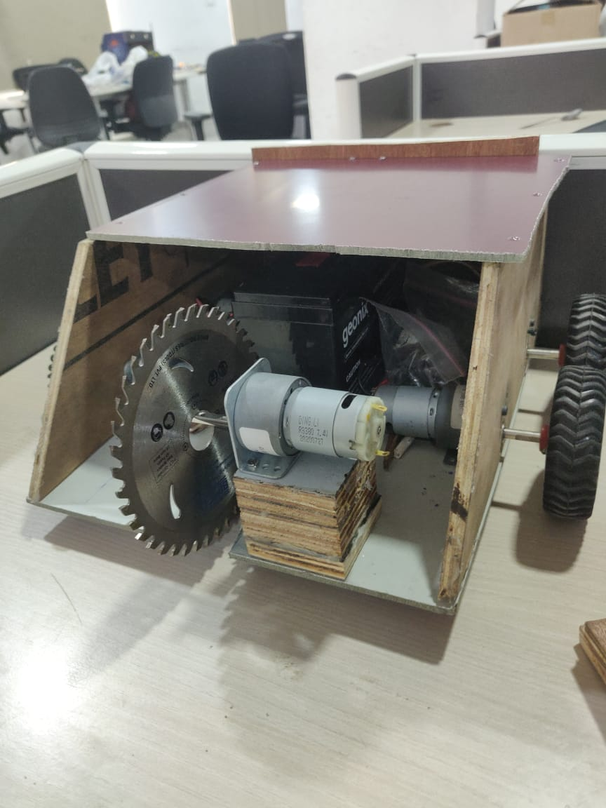
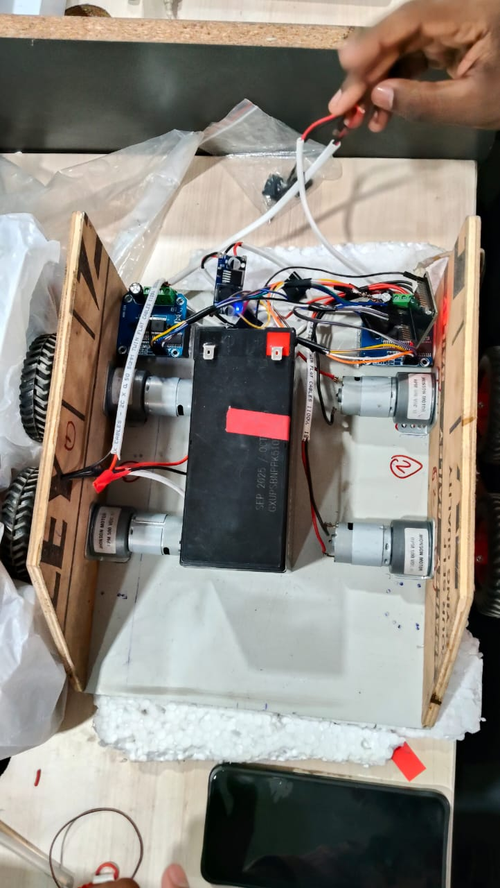

# Robo Wars Robot

A four-wheel Robo Wars robot project using an ESP32 DevKit, Bluetooth Classic control, and two IBT-2 motor-driver boards.

> **Project status:** The submitted Arduino sketch has been reported to drive the robot successfully. Power wiring, enable-pin wiring, exact motor grouping, safety behavior, and the weapon subsystem still require verification and documentation.

## Features in the current firmware

- Bluetooth Classic serial device named `MY_CAR`
- Forward, backward, left, right, and stop commands
- Six PWM speed settings
- ESP32 PWM outputs for left and right IBT-2 driver inputs
- Serial Monitor messages for debugging

## Hardware overview

- ESP32 DevKit (original ESP32 / WROOM-32 assumed; verify exact board)
- 2 × IBT-2 / BTS7960 motor-driver modules
- 4 × DC geared motors (verify model, voltage, stall current, and wiring)
- Battery: reported as 7 Ah; verify nominal voltage and chemistry
- DC-DC buck converter
- Chassis and wheels
- Horizontal rotating saw mechanism (not controlled by the current sketch)

## Robot Photos

### Front view — saw mechanism and chassis

### Top view — battery, motors, controller and wiring

## Repository layout

- `src/` — Arduino firmware and firmware notes
- `hardware/` — component list, wiring notes, and chassis design
- `images/` — actual robot and wiring photographs/diagrams
- `docs/` — project report and test records

## Build and upload

1. Install Arduino IDE and the Espressif ESP32 board package.
2. Open `src/robo_wars.ino`.
3. Select the correct ESP32 board and serial port.
4. Verify the GPIO wiring in `hardware/wiring.md`.
5. Compile and upload.
6. Test with the wheels raised, weapon disabled, and a physical power cutoff available.

The sketch uses `BluetoothSerial.h` and the newer `ledcAttach(pin, frequency, resolution)` API. Record the installed ESP32 Arduino core version in your project notes.

## Bluetooth commands

| Command | Action |
|---|---|
| `F` / `f` | Forward |
| `B` / `b` | Backward |
| `L` / `l` | Turn left |
| `R` / `r` | Turn right |
| `S` / `s` | Stop |
| `1`–`6` | Select PWM duty value |

Speed values are 50, 75, 100, 125, 175, and 255 on an 8-bit PWM scale. These are duty values, not calibrated vehicle speeds.

## Current limitations and safety

- The current sketch has no Bluetooth command timeout; motors may retain the last command if communication is lost. Add and test a failsafe before normal driving.
- The horizontal saw is not controlled by this sketch.
- Confirm enable-pin wiring, common ground, battery polarity, converter output, fusing, and emergency-stop design.
- Confirm whether each IBT-2 drives two motors in parallel and check combined motor current against the driver's ratings.
- Do not operate the saw while debugging drive electronics. Test with wheels raised and the weapon disabled.

## Team

- Institution: Malla Reddy University
- Department: Cyber Security
- Team members: **Add actual names**
- Competition / academic year: **Add confirmed details**

## Images and report

Add actual photographs to `images/` and the final report to `docs/`. Placeholder instructions are provided in those folders; no real photos were supplied with this ZIP.

## License

No license has been selected. Choose one only after the team agrees on reuse terms.
